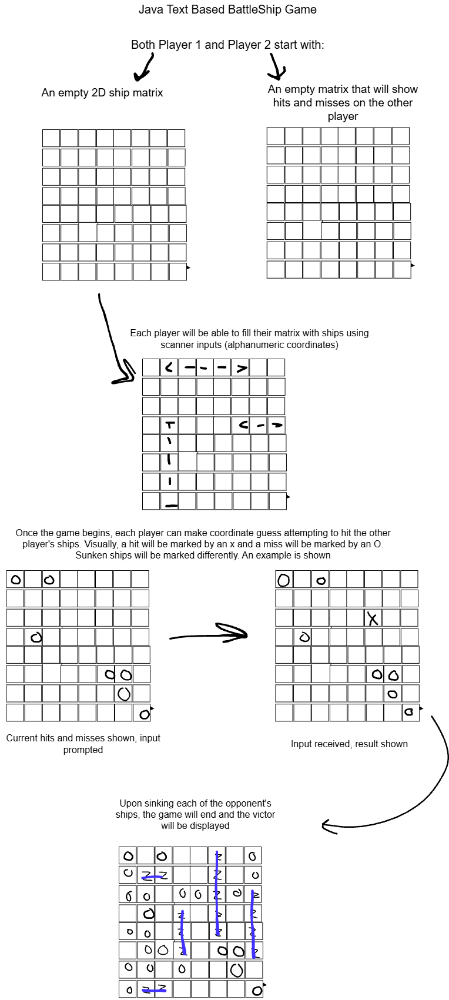

# Battleship

A program that allows two players to play a text based battleship game locally

## The Problem

I have a burning desire to play battleship in a java program. 

## How It Works

It establishes matrixes containing the positions of each player's ships and allows players to input coordinate guesses. The program checks whether the guess has matched with the position of one of the other player's ships. Once one player has lost all of their ships, a victory message will be displayed and the game will end.

## Tech Stack
- **Language:** Java
- **Libraries:** Java.util.Scanner, java.util.Arrays

## Setup / Usage

Download or clone this repository to your computer.
2. Open the project folder in your preferred Java IDE
3. Run `Main.java`  

## Roadmap

- [ ] Add menu with settings for quantity of ships, grid size, etc.
- [ ] Add sound effects
- [ ] Add ability to play CPU

## Author
Naveen Jayaraman
github.com/8NaveenJ
